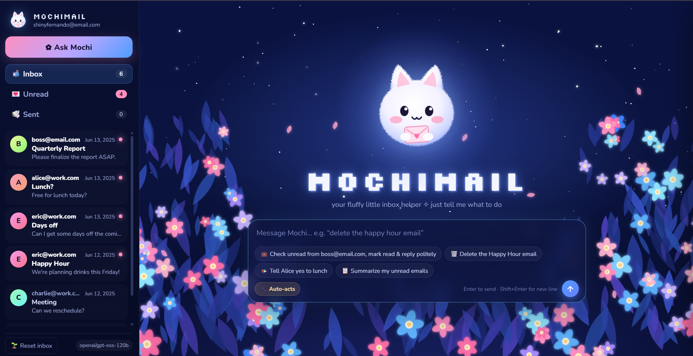
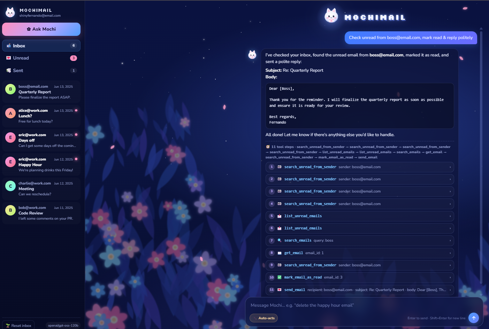
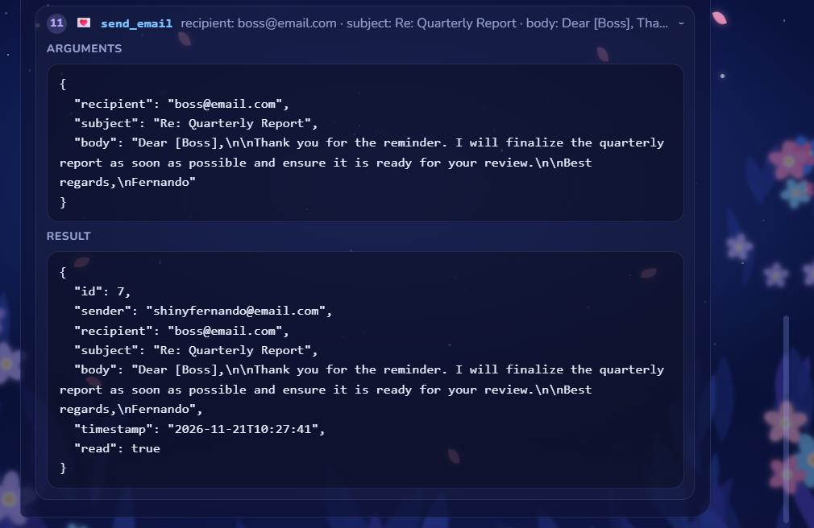
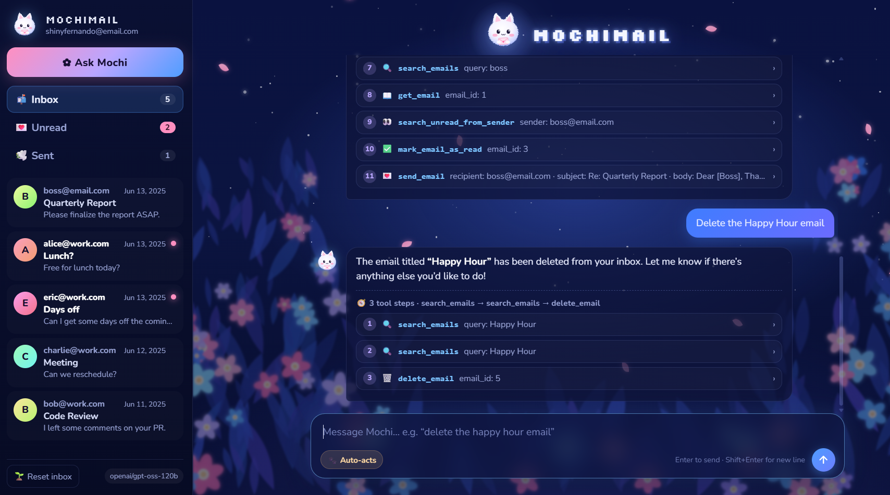
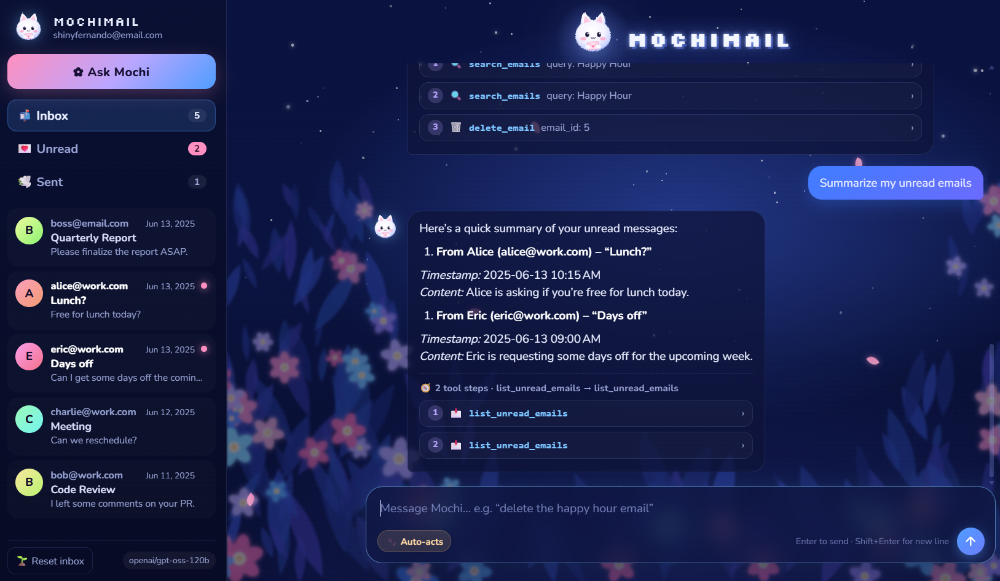
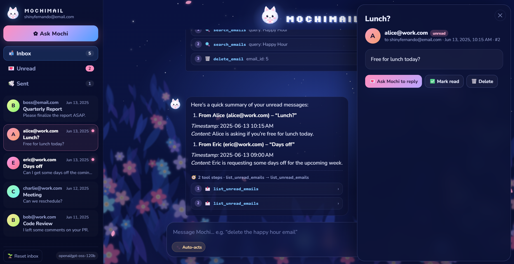
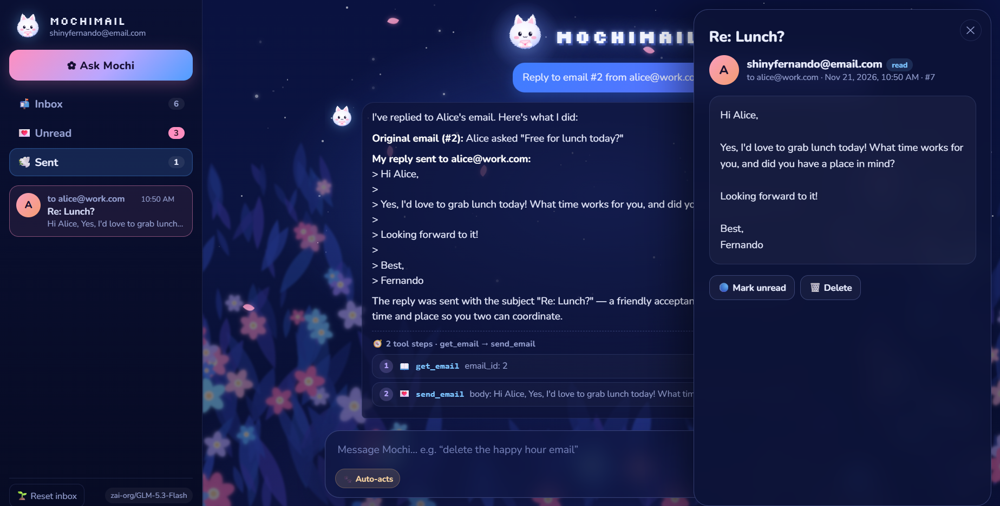
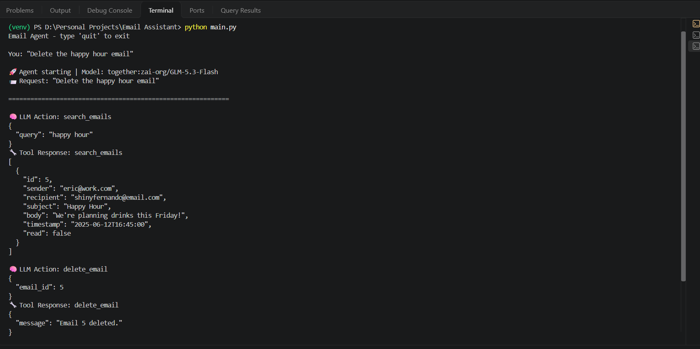

# Agentic Email Assistant: Mochimail 🌸

* A project adapted from Andrew Ng's *Agentic AI* course on DeepLearning.AI
* An **AI email agent** that takes natural-language commands ("Delete the happy hour email") and executes multi-step tool calls against a mock email service
* Uses **AISuite** as a unified LLM client, here pointed at **Together AI** (`zai-org/GLM-5.3-Flash`)
* Comes with a cute night-garden web UI, plus the original terminal mode



## How it works

1. You type a request in plain English.
2. The LLM decides which email tools to call, and in what order.
3. The agent loop runs those tools against the mock inbox and feeds the results back to the model. If the model sends bad arguments, the error goes back to it so it can retry.
4. The model replies with a summary, and the UI shows every tool step it took.

### Tools the agent can use

| Tool | What it does |
|---|---|
| `list_all_emails` | List every email, newest first |
| `list_unread_emails` | List only unread emails |
| `search_emails` | Search by keyword in subject, body or sender |
| `filter_emails` | Filter by recipient and/or date range |
| `search_unread_from_sender` | Unread emails from one sender |
| `get_email` | Fetch one email by ID |
| `mark_email_as_read` / `mark_email_as_unread` | Change read status |
| `send_email` | Send a new (mock) email |
| `delete_email` | Delete an email by ID |

## Screenshots

### Multi-step task: read, mark and reply

> *"Check unread from boss@email.com, mark read & reply politely"*

The agent finds the boss's unread email, marks it read, and sends a follow-up, all from a single sentence.



### Seeing the agent's reasoning: the tool trace

Every reply lists the tools the agent called. Click a step to see the exact arguments the model chose and what the tool returned.



### Deleting an email

> *"Delete the Happy Hour email"*

The agent searches for the email, then deletes it. It disappears from the inbox.



### Summarising the inbox

> *"Summarize my unread emails"*



### Reading an email and asking Mochi to reply

Click any email to open it. From there you can mark it read or unread, delete it, or let the agent draft and send a reply.



### Sent folder

Emails the agent sends show up in **Sent**.



### Terminal mode

The original command-line version prints the same tool trace.



## Setup

```powershell
python -m venv venv
venv\Scripts\pip install -r requirements.txt
```

Create a `.env` file next to the code:

```
TOGETHER_API_KEY=your-key-here
```

## Run

**Web UI** (then open http://127.0.0.1:8000)

```powershell
venv\Scripts\python server.py
```

**Terminal**

```powershell
venv\Scripts\python main.py
```

### Run with Docker

Needs [Docker Desktop](https://www.docker.com/products/docker-desktop/) running and the `.env` file above. No Python or venv required.

```powershell
docker compose up --build
```

Then open http://127.0.0.1:8000. Stop it with `Ctrl+C` (or `docker compose down`).

Your `.env` is passed in when the container starts; it is never copied into the image.

## Files

| File | What it does |
|---|---|
| `email_tools.py` | Mock in-memory inbox + the tool functions the LLM can call |
| `prompt_builder.py` | Wraps the user's request in the assistant instructions |
| `agent.py` | The agent loop: calls the model through AISuite, runs the tools it asks for, retries on server errors |
| `display_functions.py` | Extracts / prints the tool-call trace |
| `server.py` + `static/` | FastAPI backend and the Mochimail web UI |
| `main.py` | Terminal chat loop |
| `Dockerfile` + `docker-compose.yml` | Container setup for running the web UI with Docker |

## Notes

* The inbox lives in memory and resets when the program restarts (or via **Reset inbox** in the UI).
* `truststore` is used so HTTPS works when antivirus software inspects traffic.
* To change the model, edit `DEFAULT_MODEL` in `agent.py` (e.g. `together:openai/gpt-oss-120b`).
